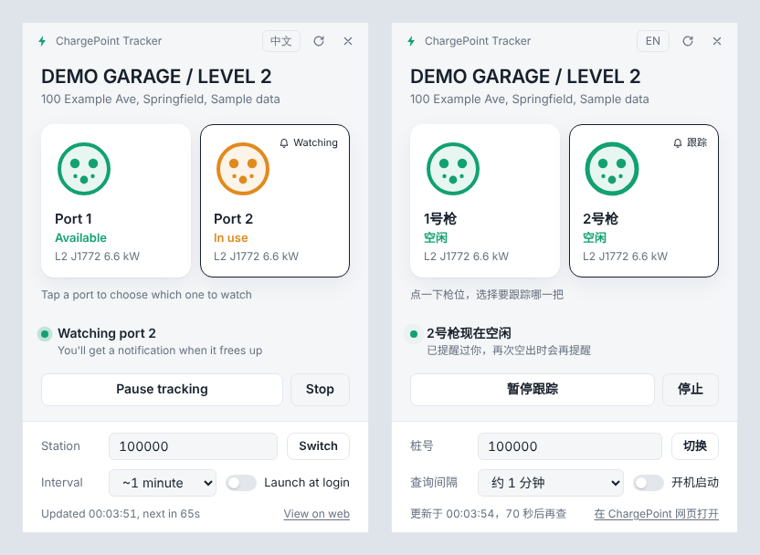

# ChargePoint Tracker for Windows

A small Windows tray app that watches a ChargePoint EV charging station and pops up a desktop notification the moment the port you want frees up. No more refreshing the ChargePoint app while you wait for a spot.



*Screenshots use made-up sample data.*

## Features

- **Lives in the system tray.** The tray icon's color shows the current state at a glance, and closing the window just hides it to the tray.
- **Desktop notification when a port frees up.** You get one alert when the port goes from busy to available, not one every minute. Clicking the notification opens the panel.
- **Live station panel.** Each port shows its status (available, in use, in use by you, or unavailable), along with level, connector type, and power.
- **Switch stations.** Enter any station number; recently used numbers are remembered.
- **Start, pause, and stop tracking.**
  - **Pause** keeps the last-seen state, so resuming won't re-alert you if nothing changed.
  - **Stop** clears the state, so starting again alerts you right away if the port is already free.
- **Polite polling.** Choose an interval of about 30 s, 1 min, 2 min, or 5 min. Each wait is randomized by ±20% so requests don't land on a fixed beat. After an error the wait backs off exponentially (up to 10×), and after an HTTP 429 it backs off up to 30 minutes.
- **Launch at login.** Starts quietly in the tray and resumes tracking if it was running when you quit.
- **English and 中文.** Follows the Windows display language by default. Switch with the button in the title bar or from the tray menu.
- **Light and dark themes,** following your Windows setting.

### Tray icon colors

| Color | Meaning |
| --- | --- |
| Grey | Not tracking |
| Blue | Tracking; the port is busy |
| Green | Tracking; the port is available |
| Amber | Paused |

## Download

Get `ChargePointTracker-<version>-portable.exe` from the [Releases](https://github.com/hupei1991/chargepoint-tracker-win/releases) page. It is a single portable executable with no installer.

The build is not code-signed, so Windows SmartScreen may warn the first time you run it. Click **More info**, then **Run anyway**.

## Usage

1. Run the exe. A lightning-bolt icon appears in the tray. If you don't see it, it may be hidden under the `^` overflow arrow; drag it onto the taskbar to keep it visible.
2. Click the tray icon to open the panel.
3. Enter your station number and click **Switch**. Find the station on the [ChargePoint website](https://driver.chargepoint.com/); the number is the last part of its URL, `https://driver.chargepoint.com/stations/<number>`.
4. Click the port you want to watch.
5. Click **Start tracking**.

To quit, right-click the tray icon and choose **Quit**.

Settings are saved to `%APPDATA%\ChargePoint Tracker\settings.json`.

## How it works

The app polls the same public JSON endpoint that the ChargePoint driver website uses to show a station's status:

```
https://mc.chargepoint.com/map-prod/v3/station/info?deviceId=<station number>
```

No ChargePoint account or login is needed. This endpoint is undocumented and may change or stop working without notice.

## Build from source

You need [Node.js](https://nodejs.org/) 20 or later.

```bash
npm install
npm start          # run the app
npm test           # unit tests for the tracking logic and translations
npm run dist       # build the portable exe into dist/
```

To build a Windows binary on Linux or macOS, `npm run dist` also works; it uses electron-builder's bundled tools.

### Developing without hitting the real API

```bash
# PowerShell
$env:CP_MOCK = "1"; npm start
# macOS / Linux
CP_MOCK=1 npm start
```

`CP_MOCK=1` serves fake station data from `dev/mock.js`. To control the sequence of states, set `CP_MOCK_SEQ`, for example `CP_MOCK_SEQ=in_use,in_use,available`.

### Project layout

```
src/
  main.js       Electron main process: tray, window, notifications, settings
  tracker.js    Polling, state transitions, jitter and backoff (no Electron dependency)
  i18n.js       English and Chinese strings
  preload.js    Safe bridge between the window and the main process
renderer/       Panel UI (HTML, CSS, JS)
assets/         App and tray icons
dev/            Mock API and screenshot helper, used for development only
test/           Unit tests (plain Node, no framework)
```

## Disclaimer

This is an unofficial personal project. It is not affiliated with, endorsed by, or supported by ChargePoint, Inc. "ChargePoint" is a trademark of its owner. Please keep the polling interval reasonable.

## License

[MIT](LICENSE)
